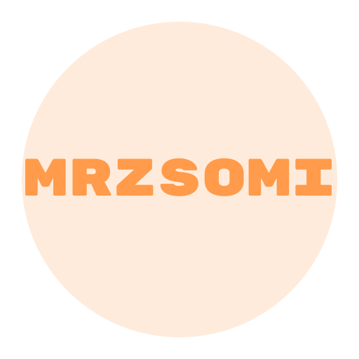

# mrzsomi.top

[English](#english) · [Magyar](#magyar)

## English

### What this is

This is the personal site and project notebook of **mrzsomi**, a Hungarian student interested in electronics and many other things. It brings together embedded systems, firmware experiments, small web tools, self-hosted infrastructure and whatever I am currently learning. The writing is intentionally straightforward: each project should explain what it does and why it exists, not just list a stack.

### What you can find here

- A bilingual portfolio in English and Hungarian
- Project notes covering Arduino, ESP32, motion control, PCB work, Java services and homelab infrastructure
- Links to live sites, source repositories and documentation where they exist
- Public GitHub activity, with graceful fallback when the API is unavailable
- A responsive layout with light and dark themes
- A contact form powered by Formspree

### Technical notes

The site is deliberately framework-free: semantic HTML, CSS and browser JavaScript are served as static files through GitHub Pages. Project content lives in `projects.en.json` and `projects.hu.json`, so new work can be added without changing the page structure. Cloudflare sits in front of the site, while GitHub provides the project and activity links.

### Links

- Website: https://mrzsomi.top
- GitHub: https://github.com/SajtosZsomle
- English project data: https://mrzsomi.top/projects.en.json
- Hungarian project data: https://mrzsomi.top/projects.hu.json

This is a personal repository rather than a collaborative project. Suggestions are welcome through the contact form, but external pull requests are not part of the current workflow.

## Magyar

### Mi ez?

Ez **mrzsomi** személyes weboldala és projekt-naplója. Magyar diákként az elektronika és még sok minden más érdekel; itt gyűjtöm össze a beágyazott rendszerekkel, firmware-kísérletekkel, elektronikával, kisebb webes eszközökkel és saját üzemeltetésű infrastruktúrával kapcsolatos munkáimat. A cél nem a technológiák felsorolása, hanem annak bemutatása, hogy az egyes projektek mit oldanak meg és miért készültek.

### Mit találsz az oldalon?

- Angol és magyar nyelvű, kétnyelvű portfóliót
- Arduino-, ESP32-, mozgásvezérlési, NYÁK-tervezési, Java- és homelab-projekteket
- Forráskód-, élő oldal- és dokumentációs hivatkozásokat, ahol rendelkezésre állnak
- Nyilvános GitHub-aktivitást, tartalék megjelenítéssel API-hiba esetére
- Reszponzív felületet világos és sötét témával
- Formspree-alapú kapcsolatfelvételi űrlapot

### Technikai háttér

Az oldal szándékosan nem használ frameworköt: szemantikus HTML, CSS és böngészőben futó JavaScript alkotja, statikus fájlként GitHub Pages szolgálja ki. A projektek tartalma a `projects.en.json` és `projects.hu.json` fájlokban található, így új munka hozzáadásához nem kell a HTML szerkezetét módosítani. A webhely előtt Cloudflare működik, a projekt- és aktivitáslinkek pedig GitHubhoz kapcsolódnak.

### Linkek

- Weboldal: https://mrzsomi.top
- GitHub: https://github.com/SajtosZsomle
- Angol projektadatok: https://mrzsomi.top/projects.en.json
- Magyar projektadatok: https://mrzsomi.top/projects.hu.json

Ez egy személyes repository, nem közös fejlesztésre szánt projekt. Észrevételeket a kapcsolatfelvételi űrlapon keresztül szívesen fogadok, de külső pull requestek kezelése jelenleg nem része a munkafolyamatnak.

---

© 2026 mrzsomi. Minden jog fenntartva.
